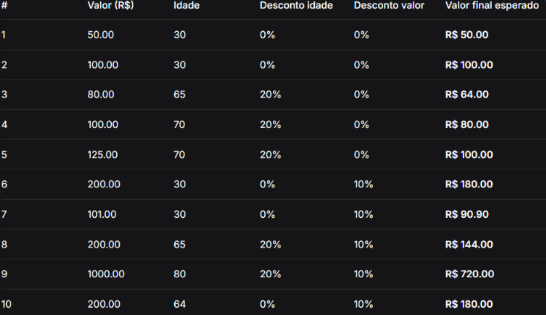

# Sistema PDV com Descontos (Desafio Nível 1)

## O que o código faz
Este projeto consiste em um sistema de Ponto de Venda (PDV) desenvolvido em Python que automatiza o registro de transações comerciais. O programa aplica regras hierárquicas de descontos baseadas na idade do cliente e no valor da compra, armazenando o histórico de cada atendimento e gerando um relatório financeiro completo e consolidado ao final do dia.

## Como ele faz
O funcionamento do programa segue um fluxo contínuo e estruturado:
1. O sistema inicia um loop contínuo (`while True`) aguardando os dados de entrada.
2. O usuário insere o valor numérico da compra e a idade do cliente, com validações integradas para impedir valores negativos.
3. Caso o valor da compra seja `0`, o loop é encerrado imediatamente.
4. O programa verifica a **Regra 1**: se a idade for maior ou igual a 65 anos, é aplicado um desconto de 20% sobre o valor original.
5. Em seguida, verifica a **Regra 2**: se o valor resultante do desconto de idade for superior a R$ 100,00, aplica-se um desconto extra de 10% sobre esse montante atualizado.
6. Os detalhes de cada atendimento (valor original, idade, descontos e valor final) são salvos em um dicionário e adicionados a uma lista de histórico de vendas através de `.append()`.
7. Ao encerrar o programa, o sistema exibe um relatório geral contendo a quantidade de compras, o total bruto, os descontos detalhados e o valor líquido arrecadado no dia.

## Como rodar
Certifique-se de ter o Python instalado em seu computador. Abra o terminal na pasta do projeto e execute o seguinte comando:

```bash
python pdv.py
```

## Casos de Teste

